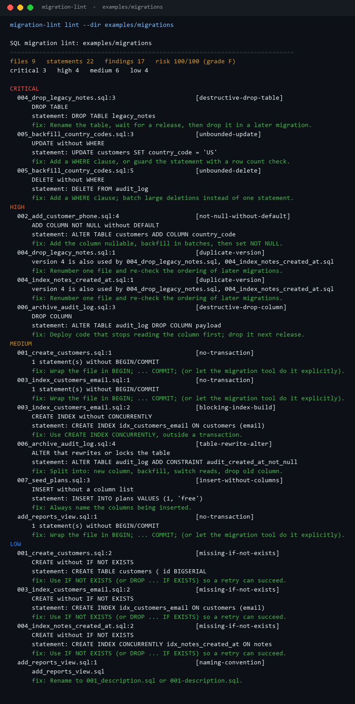
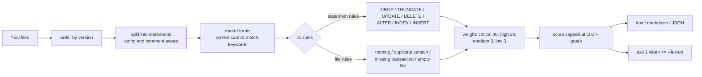
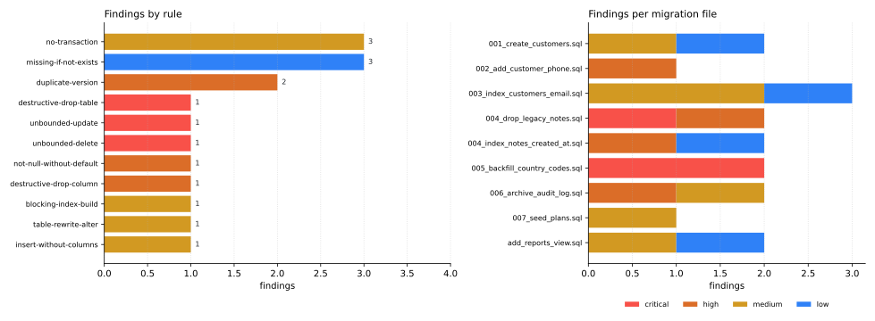

# SQL-Migration-Linter

[](https://github.com/abubakarsiddique360/SQL-Migration-Linter/actions/workflows/ci.yml)


Review a migrations directory like you review code: 15 rules, one risk score, a stable exit code,
and findings that explain the fix instead of just naming the problem.

```text
files 9   statements 22   findings 17   risk 100/100 (grade F)
critical 3   high 4   medium 6   low 4
```

The linter reads SQL, not a live database. No connection string, no credentials, no PHP or Go
runtime - just `*.sql` files and the standard library.

## The report



## Why it exists

The riskiest line in a deploy is usually a migration: `DROP TABLE`, `DELETE` without a `WHERE`, an
`ALTER` that locks a large table, or two files that both claim version 4. None of that shows up in a
code review of the surrounding service, and none of it fails a unit test.

Migration linters tend to be either heavy framework plugins or one regex for `DROP TABLE`. This one
sits in between: a real SQL lexer that ignores strings and comments, a rule per failure mode, a
severity-weighted score, and a `--fail-on` flag a CI job can use.

## How it works



Two properties matter more than the rule list:

**The lexer is not a regex.** `INSERT ... VALUES ('DELETE FROM users')` is one statement with a
string in it, not a `DELETE`. Statements are split on semicolons outside quotes and comments,
literals are masked, and every finding carries the line number where its statement begins.

**The score is boring on purpose.** Each finding adds a fixed weight, the total is capped at 100, and
grades map to score bands. There is no hidden multiplier, so a reviewer can recompute the number by
hand and argue with the weights instead of the tool.

## Rules

| Code | Severity | Flags |
| --- | --- | --- |
| `destructive-drop-table` | critical | `DROP TABLE` |
| `destructive-drop-object` | critical | `DROP DATABASE` / `DROP SCHEMA` |
| `unbounded-update` | critical | `UPDATE` without `WHERE` |
| `unbounded-delete` | critical | `DELETE` without `WHERE` |
| `destructive-drop-column` | high | `ALTER TABLE ... DROP COLUMN` |
| `truncate-table` | high | `TRUNCATE` |
| `not-null-without-default` | high | adds `NOT NULL` without `DEFAULT` |
| `duplicate-version` | high | two files share a numeric version |
| `blocking-index-build` | medium | `CREATE INDEX` without `CONCURRENTLY` |
| `table-rewrite-alter` | medium | column type change, `SET NOT NULL`, `ADD CONSTRAINT` |
| `insert-without-columns` | medium | `INSERT ... VALUES` with no column list |
| `no-transaction` | medium | schema changes without `BEGIN` / `COMMIT` |
| `missing-if-not-exists` | low | `CREATE TABLE` / `INDEX` without `IF NOT EXISTS` |
| `naming-convention` | low | file is not `<version>_<name>.sql` |
| `empty-migration` | low | file contains no statements |

`migration-lint explain <code>` prints the reasoning and the fix, e.g.
`migration-lint explain unbounded-delete`.

## Findings map



The `examples/migrations` fixture is intentionally messy: it shows a duplicate version, two
unbounded writes in one file, a dropped column next to an added constraint, and a file that predates
the naming convention. Three critical findings already exceed the 100 point cap - that is the score
doing its job, not a rounding accident.

## Usage

```bash
migration-lint lint --dir examples/migrations
migration-lint lint --dir examples/migrations --format markdown --fail-on high
migration-lint lint --file db/migrations/001_init.sql --fail-on never
migration-lint scan --dir examples/migrations
migration-lint rules
migration-lint explain table-rewrite-alter
```

Exit codes: `0` nothing at or above `--fail-on` (default `high`), `1` findings at or above the
threshold, `2` bad arguments or unreadable input.

A CI step that fails a pull request on high or critical findings:

```yaml
- name: Migration risk review
  run: |
    pip install sql-migration-linter
    migration-lint lint --dir db/migrations --format markdown --fail-on high >> "$GITHUB_STEP_SUMMARY"
```

## Reading the report

| Severity | Count | What to do |
| --- | ---: | --- |
| critical | 3 | Do not deploy. Every one of these destroys or rewrites data. |
| high | 4 | Needs a plan: duplicate version, dropped column, `NOT NULL` without a default. |
| medium | 6 | Can ship, but split the statement or wrap the file in a transaction first. |
| low | 4 | Hygiene: naming, `IF NOT EXISTS`. |

`--format json` returns the same data for a dashboard:

```json
{
  "score": 100,
  "grade": "F",
  "counts": {"critical": 3, "high": 4, "medium": 6, "low": 4},
  "files": [{"file": "004_drop_legacy_notes.sql", "version": 4, "statements": 3, "score": 40}],
  "findings": [{"code": "destructive-drop-table", "severity": "critical", "file":
                "004_drop_legacy_notes.sql", "line": 3, "message": "DROP TABLE"}]
}
```

## Design notes and limits

- **Heuristics, not a parser.** The statement splitter handles `'...'`, `"..."`, `--` comments and
  `/* ... */` blocks. It does not implement PostgreSQL dollar quoting (`$tag$ ... $tag$`); a
  migration that uses it may be split incorrectly.
- **Dialect hints.** `CONCURRENTLY` and table-rewrite guidance are PostgreSQL-flavoured. The
  destructive and unbounded rules apply to any SQL engine.
- **File-level transaction detection is textual.** If you rely on your migration runner to wrap
  files, set the rule aside by adding a comment that says so, or accept the medium finding.
- **No connection, no schema introspection.** Rules that need catalog data - "does this column have
  an index" - are deliberately excluded rather than guessed.
- **Duplicate versions are compared per run.** Lint the whole directory, not a single file, to get
  them.

## Development

```bash
python -m pip install -e ".[dev]"
ruff check .
pytest                               # 61 tests, no database required
python scripts/render_assets.py      # regenerate docs/images and docs/lint-summary.json
```

## License

MIT - see [LICENSE](LICENSE).
